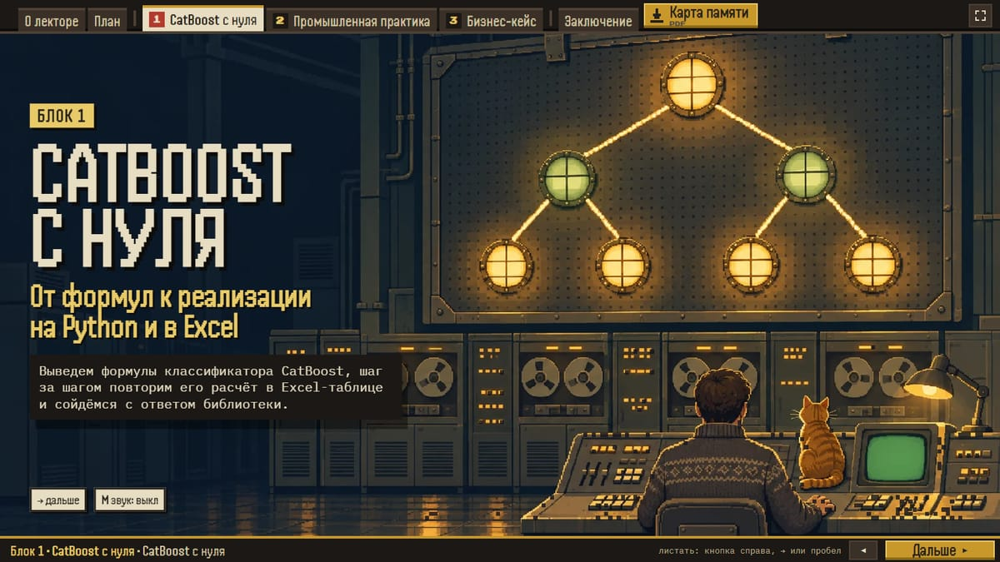
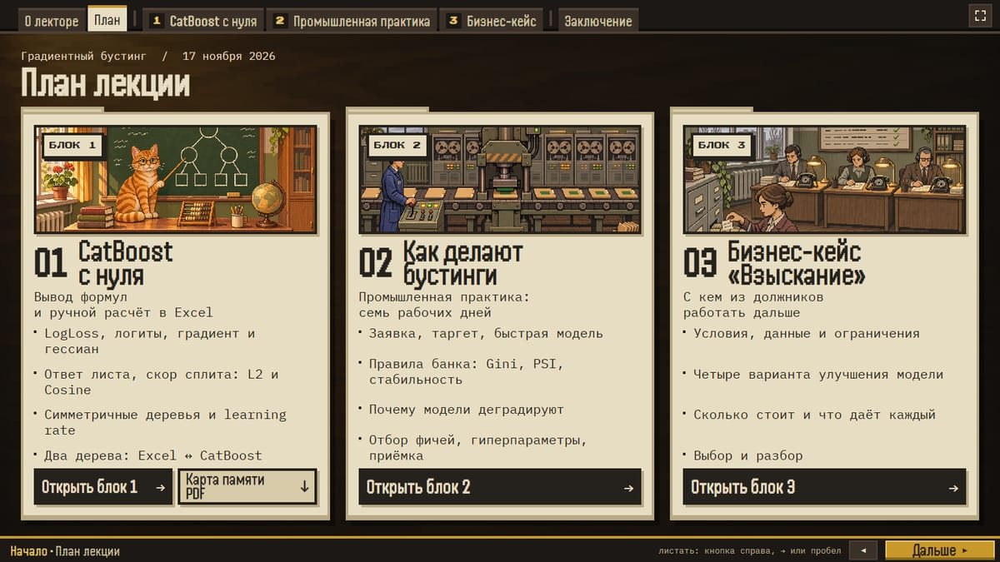
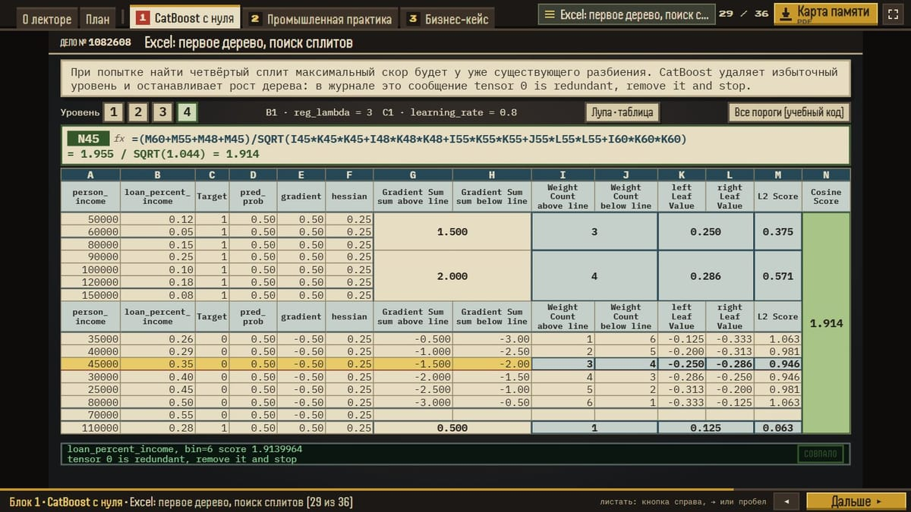
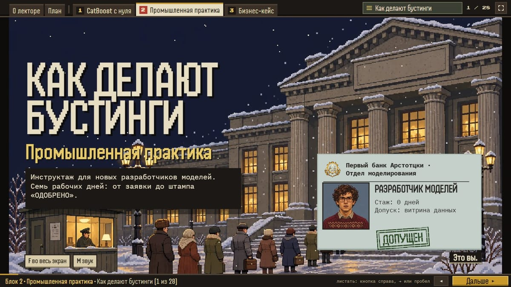
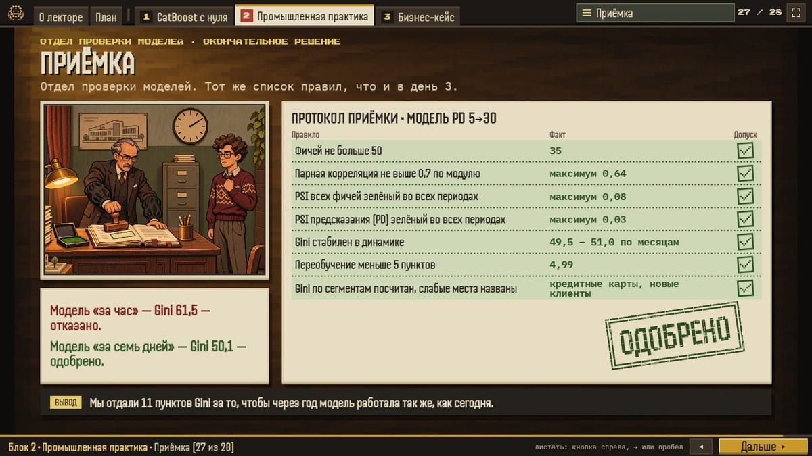
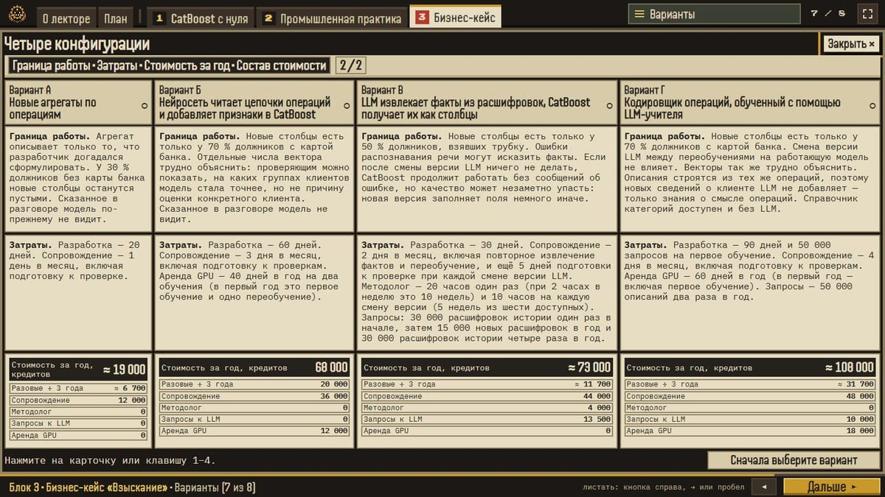
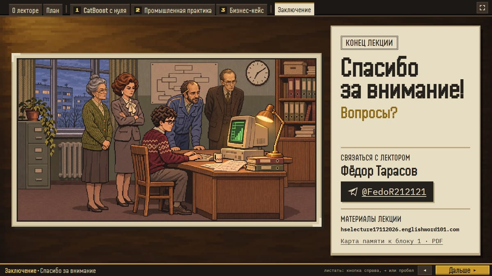

<div align="center">

<a href="https://fedortarasow.github.io/hselecture17112026/"></a>

# Градиентный бустинг: от формул CatBoost до промышленной практики

**Интерактивная лекция · 17 ноября 2026 · ВШЭ · Фёдор Тарасов**

### [▶ Открыть лекцию в браузере](https://fedortarasow.github.io/hselecture17112026/)

Ничего устанавливать не нужно: это обычный сайт. Откройте ссылку и листайте стрелкой **→**.

</div>

---

## Что это

Сайт-презентация к часовой лекции о градиентном бустинге. Три блока идут подряд, как главы книги: сначала математика, потом работа с моделью в банке, потом задача на обсуждение. Каждый слайд — живая страница: формулы раскрываются по шагам, таблицы пересчитываются, в кейсе можно выбрать решение и посмотреть, чем оно закончится.

Сайт рассчитан на большой экран или ноутбук. На телефоне откроется, но будет мелко.

## С чего начать

| Если вы… | Откройте |
|---|---|
| хотите пройти лекцию целиком | [начало](https://fedortarasow.github.io/hselecture17112026/) и жмите **→** до конца |
| хотите понять, как CatBoost считает дерево | [блок 1 · CatBoost с нуля](https://fedortarasow.github.io/hselecture17112026/#/title-catboost) |
| строите модели на работе | [блок 2 · Промышленная практика](https://fedortarasow.github.io/hselecture17112026/#/practice) |
| любите разбирать задачи | [блок 3 · Бизнес-кейс «Взыскание»](https://fedortarasow.github.io/hselecture17112026/#/title-case) |
| ищете шпаргалку по выводу формул | [карта памяти, PDF](https://fedortarasow.github.io/hselecture17112026/files/CatBoost-karta-pamyati.pdf) |

## Как управлять

| Действие | Клавиша или кнопка |
|---|---|
| Следующий шаг, слайд или блок | **→**, **пробел** или кнопка «Дальше» справа внизу |
| Назад | **←** или кнопка ◄ |
| Перейти к блоку | вкладки вверху страницы |
| Содержание блока | кнопка с названием слайда вверху справа |
| Во весь экран | кнопка в правом верхнем углу |
| Звук на титульных кадрах и в блоке 2 | **M** (по умолчанию выключен) |

Одной клавишей **→** проходится вся лекция от первого слайда до «Спасибо за внимание».

## Что внутри

<a href="https://fedortarasow.github.io/hselecture17112026/#/intro/plan"></a>

### Блок 1 · CatBoost с нуля

Вывод формул классификатора CatBoost шаг за шагом и тот же расчёт руками в Excel-таблице — до совпадения с ответом библиотеки. 36 слайдов.

- LogLoss, логиты, градиент и гессиан
- Ответ листа, скор сплита: L2 и Cosine
- Симметричные деревья и learning rate
- Два дерева: Excel = CatBoost

К блоку есть раздатка — [карта памяти](https://fedortarasow.github.io/hselecture17112026/files/CatBoost-karta-pamyati.pdf): весь вывод на двух страницах. Блок построен по [статье автора на Хабре](https://habr.com/ru/companies/vtb/articles/1082608/).

<a href="https://fedortarasow.github.io/hselecture17112026/#/catboost/s29-tree1-splits"></a>

### Блок 2 · Как делают бустинги: промышленная практика

Семь рабочих дней нового разработчика моделей в вымышленном банке: от заявки заказчика до штампа «ОДОБРЕНО». 28 слайдов.

- Заявка, таргет, быстрая модель
- Правила банка: Gini, PSI, стабильность
- Почему модели деградируют
- Отбор фичей, гиперпараметры, приёмка

<a href="https://fedortarasow.github.io/hselecture17112026/#/practice"></a> <a href="https://fedortarasow.github.io/hselecture17112026/#/practice/acceptance"></a>

### Блок 3 · Бизнес-кейс «Взыскание»

Задача на обсуждение: с кем из должников работать дальше. Даны условия, данные и ограничения, четыре варианта улучшения модели с ценой каждого. Выбираете вариант — и смотрите его разбор.

- Условия, данные и ограничения
- Четыре варианта улучшения модели
- Сколько стоит и что даёт каждый
- Выбор и разбор

<a href="https://fedortarasow.github.io/hselecture17112026/#/title-case"></a> <a href="https://fedortarasow.github.io/hselecture17112026/#/case"></a>

## Что лежит в этом репозитории

Здесь уже собранный сайт — то, что отдаёт браузеру GitHub Pages. Исходники блоков в репозиторий не входят.

| Папка или файл | Что в ней |
|---|---|
| `index.html` | оболочка: вкладки, кнопка «Дальше», переходы между блоками |
| `blocks/` | сами блоки лекции, каждый — один самодостаточный HTML-файл |
| `assets/` | шрифты, цвета и скрипт оболочки |
| `files/` | раздатка: карта памяти в PDF |
| `docs/` | картинки для этой страницы |

## Запустить у себя

Скачайте репозиторий (зелёная кнопка **Code → Download ZIP**), распакуйте и поднимите в папке любой простой веб-сервер. Например, если установлен Python:

```bash
python -m http.server 8000
```

После этого откройте в браузере `http://localhost:8000/`.

Двойной щелчок по `index.html` может не сработать: блоки загружаются во фреймах, а браузеры ограничивают их общение, когда страница открыта как файл. Через веб-сервер работает надёжно.

## Автор

**Фёдор Тарасов** — Telegram [@FedoR212121](https://t.me/FedoR212121)

<a href="https://fedortarasow.github.io/hselecture17112026/#/finale"></a>
